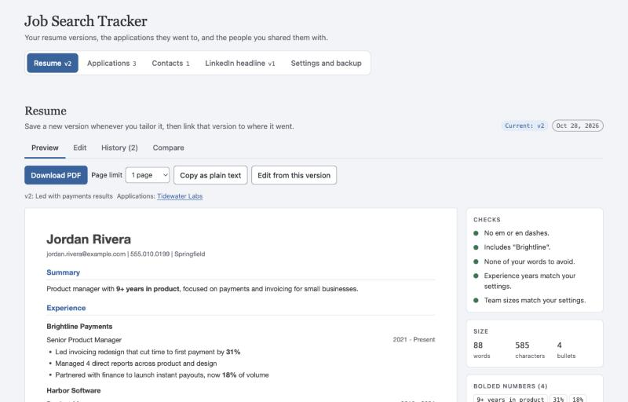

# Job Search Tracker

**Use it here: https://natalia-builds.github.io/search-pipeline-and-tracker/**

A free, private tool for running a job search. Keep every version of your resume, see exactly which version went to each company and each person, track where every application stands, and keep a history of your LinkedIn headline.

There's nothing to install and no account to create. Everything you enter stays in your browser, on your own device.



## Contents

- [What it does](#what-it-does)
- [Getting started](#getting-started)
- [Formatting your resume](#formatting-your-resume)
- [Your data and backups](#your-data-and-backups)
- [Limits](#limits)
- [Accessibility](#accessibility)
- [Questions, bugs and ideas](#questions-bugs-and-ideas)
- [For developers](#for-developers)
- [License](#license)

## What it does

**Resume**
- Save a new version every time you tailor your resume, with a note about what changed.
- Compare any two versions line by line.
- Download a PDF that fits the page limit you choose (any length, or 1 to 4 pages). The PDF is real text, so applicant tracking systems can read it.
- Copy your resume as plain text for application forms.
- Run checks you set up: words every version must include, the years of experience you claim, team sizes, words to avoid, and em dashes.

**Applications**
- Track each role from Interested through Applied, Screening, Interviewing, Offer, and Closed.
- Record the resume version you sent, the pay range, the work setup, the next step and its date, a referral, and notes.
- Get flags for overdue next steps, no posted pay range, pay below your target, and work setups you want to avoid.

**Contacts**
- Record who you shared your resume with outside an application, such as a former colleague passing it along.
- See which version each person has, and get a warning when they have an older one.
- Set follow-up dates.

**LinkedIn headline**
- Keep every headline you've used, with when and why it changed.
- Count characters against LinkedIn's 220-character limit.
- Check that any numbers in your headline match your current resume.

A version you've sent somewhere can't be deleted, so you always have a record of what each company or person received.

## Getting started

1. **Open the site** and choose **Try it with sample data** to look around with a made-up job seeker. When you're ready for your own, go to **Settings and backup → Delete everything**.
2. **Paste your resume.** Choose **Paste your resume**, paste it in, and select **Save version**. See [Formatting your resume](#formatting-your-resume) to make it look right.
3. **Set up your checks** in **Settings and backup**: your name, words every version must include, your years of experience, and any words you want to avoid. All of these are optional.
4. **Add applications** as you pursue roles, and pick the resume version you sent.
5. **Tailor and save.** When you change your resume for a role, save it as a new version and choose the role under **Tailored for**. The application then records exactly what you sent.
6. **Download a backup** from **Settings and backup** every week or two. See [Your data and backups](#your-data-and-backups) for why.

## Formatting your resume

The resume editor uses a few simple marks to know what's a heading, a bullet, or a date. This keeps your resume as plain text, which is what makes the PDF readable by applicant tracking systems.

| To get | Type |
| --- | --- |
| Your name at the top | `# ` then your name, on the first line |
| A section heading, such as Experience | `## ` then the heading |
| A company or school name | `### ` then the name |
| A bullet point | `* ` then the text |
| **Bold** text, such as a key number | `**` on both sides: `**31%**` |
| Dates lined up on the right | Press **Tab** between the job title and the dates |
| Your contact details, in smaller gray text | Put them on the line right after your name |

In the editor, the Tab key types a tab. To move on to the next field, press Esc and then Tab, or press Shift+Tab to go back. The same help, with this example, is under **How to format your resume** above the editor.

Here's a short example. The space before each date is a Tab.

```
# Jordan Rivera
jordan.rivera@example.com | 555.010.0199 | Springfield

## Experience
### Brightline Payments
Senior Product Manager	2021 - Present
* Led an invoicing redesign that cut time to first payment by **31%**
* Managed 4 direct reports across product and design

## Education
State University	B.A. Economics
```

**The quickest way in, if your resume is in Google Docs:** choose **File → Download → Markdown (.md)**, open the downloaded file in a text editor, and paste everything into the tracker. Headings come across if your resume uses Google Docs heading styles. The tracker removes the extra backslashes that Google Docs adds. If your dates don't line up on the right, put a Tab between each job title and its dates.

**If your resume is in Word or a PDF,** paste it in, then add the marks above. It usually takes a few minutes, and you only do it once.

## Your data and backups

Everything is saved in your browser's storage on your device. Nothing is sent to a server, there's no account, and there's no tracking. The page doesn't load anything from other websites.

That also means:

- **Your data is tied to one browser on one device.** Another browser, another computer, or your phone starts empty.
- **Clearing your browser data erases it.** So does uninstalling the browser. In a private or incognito window, nothing is kept after you close it.
- **A backup file is your safety net.** Choose **Settings and backup → Download backup** to save a file to your computer. Keep it somewhere safe, such as a cloud drive. The tracker reminds you when your last backup is more than two weeks old.
- **To move to another device or browser,** download a backup, open the tracker there, and choose **Restore from a backup file**.

Backups contain your resume and your contacts' details, so keep them as private as you would the resume itself.

## Limits

- **US Letter only:** PDFs are US Letter size (8.5 × 11 inches), not A4.
- **No syncing:** nothing syncs between devices. Use a backup file to move your data.
- **English only:** the tool's text is in English.
- **Simple formatting:** resumes use the marks above. There are no tables, columns, images, or custom fonts.

## Accessibility

The tracker aims to meet WCAG 2.2 Level AA. So far it has been checked for color contrast in light and dark mode, use at a 375-pixel phone width, labels and error messages on form fields, keeping keyboard focus in place, and announcing results to screen readers. It hasn't yet been tested with a screen reader by a person, or in Safari or Firefox, so it hasn't had a full accessibility review. If something doesn't work for you, please [open an issue](https://github.com/natalia-builds/search-pipeline-and-tracker/issues).

## Questions, bugs and ideas

Please [open an issue](https://github.com/natalia-builds/search-pipeline-and-tracker/issues) on GitHub. Never paste your real resume, contacts, or a backup file into an issue, because issues are public.

## For developers

The site is built with [Astro](https://astro.build) and TypeScript, tested with [Vitest](https://vitest.dev), and makes PDFs with [jsPDF](https://github.com/parallax/jsPDF). It has no server or database.

You'll need [Node.js](https://nodejs.org) 24 or newer.

```bash
npm install      # download the packages the project needs
npm run dev      # start a private preview at http://localhost:4321/search-pipeline-and-tracker/
npm test         # run the automated tests
npm run build    # build the finished site into dist/
```

**Where things live**
- `src/lib/`: the logic, with tests. Formatting, comparing versions, checks, saving and backups, PDFs, and the sample data.
- `src/scripts/app.ts`: the interactive page.
- `src/pages/index.astro`: the page shell. `src/styles/app.css`: styles and colors.
- `CLAUDE.md`: the project's principles and workflow.

**Publishing:** every pull request is tested and built by GitHub Actions. Merging into `main` publishes the site to GitHub Pages automatically.

**Contributing:** open an issue first to talk through the change. Then make a branch, keep the pull request to one purpose, and run `npm test` and `npm run build` before you push. Please keep the tracker private by default: no accounts, analytics, or requests to other sites.

## License

[MIT](LICENSE). The Carlito font used in PDFs is under the [SIL Open Font License](public/fonts/OFL.txt).
