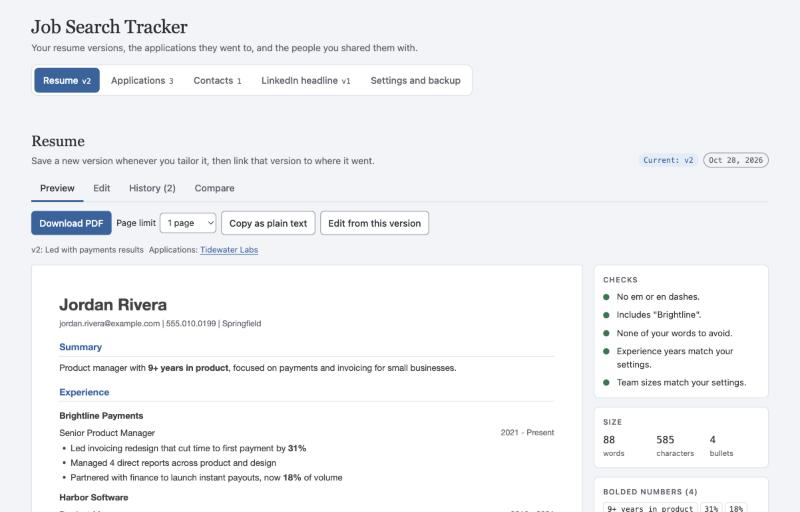

# Job Search Tracker

A free, private tool for running a job search, in your browser. It keeps every version of your resume, shows which version went to each company and each person, tracks where every application stands, and saves a history of your LinkedIn headline. There is nothing to install and no account to create, and everything you enter stays in your browser, on your own device.

**Try it:** [the live site](https://natalia-builds.github.io/search-pipeline-and-tracker/)

## Contents

- [Status](#status)
- [Who it's for and the problem it solves](#who-its-for-and-the-problem-it-solves)
- [What it does today](#what-it-does-today)
- [Design decisions and tradeoffs](#design-decisions-and-tradeoffs)
- [Roadmap](#roadmap)
- [Limitations and known gaps](#limitations-and-known-gaps)
- [How to use it](#how-to-use-it)
  - [First steps](#first-steps)
  - [Your data and backups](#your-data-and-backups)
- [For developers](#for-developers)
  - [Run it for development](#run-it-for-development)
  - [Where things live](#where-things-live)
  - [Contributing](#contributing)
  - [License](#license)

## Status

**This browser version is complete and is no longer where new work happens.** It does everything described below, and it stays online. Future improvements go to the [local app](https://github.com/natalia-builds/search-pipeline-tracker-app), which is the same tracker with its data saved to a file on your computer instead of in your browser.

- **Choose this version** if you want nothing to install and are fine with your data living in one browser on one device.
- **Choose the local app** if you want your data in a file you own, with automatic daily copies. It has installers for macOS, Windows and Linux.
- **Already have data here?** Download a backup from Settings and follow [Moving over from the browser version](https://github.com/natalia-builds/search-pipeline-tracker-app#moving-over-from-the-browser-version) in the app's README.

**What has been tested:**

- The resume logic (formatting, comparing versions, checks), headline checks, application flags, saving and backups, and PDF page limits have automated tests. GitHub Actions runs them, and builds the site, on every pull request.
- The screens have been checked for color contrast in light and dark mode, use at a 375-pixel phone width, labels and error messages on form fields, keeping keyboard focus in place, and announcing results to screen readers.
- A person has not yet tested the screens with a screen reader, or in Safari or Firefox.

## Who it's for and the problem it solves

Anyone running a job search who tailors their resume for each role. A search produces many versions of a resume, many applications, and people who passed the resume along. It gets hard to say which version a company, or a former colleague, actually has. A spreadsheet can list where you applied, but it can't hold each version or compare them. Hosted trackers keep your resume and your contacts' details on someone else's servers.

The tracker is built around four things:

1. **Resume versions:** save a new version each time you tailor it, with a note about what changed, and compare any two.
2. **Applications:** track each role from Interested to Offer, and record the version you sent.
3. **Contacts:** record who you shared a version with outside an application, and get a warning when they have an older one.
4. **LinkedIn headline:** keep every headline you've used, with when and why it changed.

A version you've sent somewhere can't be deleted, so you always have a record of what each company or person received.

## What it does today



- **Resume:** save a new version every time you tailor your resume, with a note about what changed. Compare any two versions line by line. Download a PDF that fits the page limit you choose (any length, or 1 to 4 pages, as real text that applicant tracking systems can read). Copy the resume as plain text for application forms.
- **Checks you set up yourself:** words every version must include, the years of experience you claim, team sizes, words to avoid, and em dashes. Nothing is built in, so every check comes from your own settings.
- **Applications:** track each role from Interested through Applied, Screening, Interviewing, and Offer. When a role ends, mark it Rejected (the company passed), Withdrawn (you pulled out), or Closed (filled, paused, or went quiet). Ended roles leave the Active count. Record the resume version you sent, the pay range, the work setup, the next step and its date, a referral, and notes. Get flags for overdue next steps, no posted pay range, pay below your target, and work setups you want to avoid.
- **Contacts:** record who you shared your resume with outside an application, such as a former colleague passing it along. See which version each person has, and set follow-up dates.
- **LinkedIn headline:** a count against LinkedIn's 220-character limit, and a check that the numbers in your headline match your current resume.
- **Backup and restore:** a download of everything as one file, and a restore from it.

## Design decisions and tradeoffs

- **The data stays in the browser.** Everything is saved in the browser's `localStorage` under one key (`spt.library`), and the site has no server or database. That makes it private and free to host, and nothing needs to be installed. The tradeoff is that the data is tied to one browser on one device, and clearing the browser's data erases it.
- **Backups are the safety net.** A backup is one `.json` file the person downloads and keeps. The tracker reminds you when the last one is more than two weeks old. Older backups keep loading: data is filled in and cleaned up when it is read, and the saved data carries a schema version, so a change to its shape doesn't strand old files.
- **Never lose data silently.** If saved data exists but can't be read, the raw text is kept and an error is reported instead of overwriting it. The tradeoff is that the person may have to restore from a backup.
- **Private by default.** There are no accounts, no analytics, and no requests to other websites. Fonts and libraries are bundled instead of loaded from a CDN. The tradeoff is that the project has no usage numbers and can only learn how people use it if they say so.
- **Nothing personal is built in.** No name, employer, number, or city is written into the code. Every check and threshold comes from the person's Settings.
- **A static site on GitHub Pages.** It started as a personal Claude artifact and was rebuilt as a standalone static site so anyone can use it. Merging into `main` publishes it automatically. The tradeoff is that anything merged goes public, so every change is reviewed in a pull request first.
- **Accessibility is a requirement, not an extra.** The screens aim to meet WCAG 2.2 Level AA: real HTML controls, full keyboard use, labels on every field, errors linked to their field, results announced to screen readers, and enough contrast in light and dark mode. [Limitations](#limitations-and-known-gaps) says what hasn't been verified.

**Deliberately not built:** accounts or sign-in, a server or database, syncing between devices, analytics or tracking, and requests to other websites.

## Roadmap

No further stages are planned for this browser version. New work happens in the local app, and its stages are in its [README](https://github.com/natalia-builds/search-pipeline-tracker-app#roadmap).

Beyond these, nothing is committed.

## Limitations and known gaps

- **Your data is tied to one browser on one device.** Another browser, another computer, or a phone starts empty. Clearing the browser's data erases it, and so does uninstalling the browser. In a private or incognito window, nothing is kept after the window closes.
- **Nothing syncs between devices.** Use a backup file to move your data.
- **Accessibility isn't fully verified.** A person hasn't tested the screens with a screen reader, in Safari or Firefox, or in a full accessibility review.
- **PDFs are US Letter only** (8.5 × 11 inches), not A4, and the tool's text is English only.
- **Resumes use simple marks** for headings, bullets, and dates. There are no tables, columns, images, or custom fonts. See [Formatting your resume](docs/formatting-your-resume.md).

---

## How to use it

Open the [live site](https://natalia-builds.github.io/search-pipeline-and-tracker/). There is nothing to install.

### First steps

1. **Open the site** and choose **Try it with sample data** to look around with a made-up job seeker. When you're ready for your own, go to **Settings and backup → Delete everything**.
2. **Paste your resume.** Choose **Paste your resume**, paste it in, and select **Save version**. See [Formatting your resume](docs/formatting-your-resume.md) to make it look right.
3. **Set up your checks** in **Settings and backup**: your name, words every version must include, your years of experience, and any words you want to avoid. All of these are optional.
4. **Add applications** as you pursue roles, and pick the resume version you sent.
5. **Tailor and save.** When you change your resume for a role, save it as a new version and choose the role under **Tailored for**. The application then records exactly what you sent.
6. **Download a backup** from **Settings and backup** every week or two. See [Your data and backups](#your-data-and-backups) for why.

### Your data and backups

Everything is saved in your browser's storage on your device. Nothing is sent to a server, there's no account, and there's no tracking. The page doesn't load anything from other websites.

That also means:

- **Your data is tied to one browser on one device.** Another browser, another computer, or your phone starts empty.
- **Clearing your browser data erases it.** So does uninstalling the browser. In a private or incognito window, nothing is kept after you close it.
- **A backup file is your safety net.** Choose **Settings and backup → Download backup** to save a file to your computer. Keep it somewhere safe, such as a cloud drive. The tracker reminds you when your last backup is more than two weeks old.
- **To move to another device or browser,** download a backup, open the tracker there, and choose **Restore from a backup file**.

Backups contain your resume and your contacts' details, so keep them as private as you would the resume itself.

---

## For developers

The site is built with [Astro](https://astro.build) and TypeScript, tested with [Vitest](https://vitest.dev), and makes PDFs with [jsPDF](https://github.com/parallax/jsPDF). It has no server or database. GitHub Actions tests and builds every pull request, and merging into `main` publishes the site to GitHub Pages automatically.

### Run it for development

You'll need [Node.js](https://nodejs.org) 24 or newer.

```bash
npm install      # download the packages the project needs
npm run dev      # start a private preview at http://localhost:4321/search-pipeline-and-tracker/
npm test         # run the automated tests
npm run build    # build the finished site into dist/
```

### Where things live

- [Resume formatting guide](docs/formatting-your-resume.md): the marks the editor understands
- `src/lib/`: the logic, with tests. Formatting, comparing versions, checks, saving and backups, PDFs, and the sample data.
- `src/scripts/app.ts`: the interactive page.
- `src/pages/index.astro`: the page shell. `src/styles/app.css`: styles and colors.
- `.github/workflows/publish.yml`: tests and builds every pull request, and publishes to GitHub Pages when something is merged into `main`.
- [CLAUDE.md](CLAUDE.md): the project's principles and working rules

### Contributing

Issues are welcome. [Open one](https://github.com/natalia-builds/search-pipeline-and-tracker/issues) to report a problem or suggest an idea, and open one before a larger change so it can be talked through. Then make a branch, keep the pull request to one purpose, and run `npm test` and `npm run build` before you push. Please keep the tracker private by default: no accounts, analytics, or requests to other sites. Never paste your real resume, contacts, or a backup file into an issue, because issues are public.

### License

[MIT](LICENSE). The Carlito font used in PDFs is under the [SIL Open Font License](public/fonts/OFL.txt).
